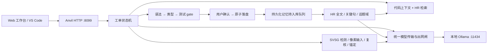

# Anvil 原生集成考核版

本地模型驱动的单文件 Python 编码 Agent。工单状态机负责执行与验证，HR 负责项目记忆，SVSG 负责看图和结构化证据。三者的源码、配置、运行目录与日志统一在本仓库；运行时通过 Python 对象调用，无需另外启动 HR、SVSG 或模型网关进程。

## 考核入口（3 × 25 分）

本项目选择“大模型工程开发”路线。考核材料从 [考核总览](docs/assessment/考核总览.md) 开始：

| 要求 | 材料与操作 |
|---|---|
| AI 基础理论学习 25 | [理论与实现](docs/assessment/理论与实现.md)：原理、实现定位、实验、答辩题及本人学习记录 |
| 大模型工程 / 工作流开发 25 | [工程说明与演示](docs/assessment/工程说明与演示.md)：真实代码工单、验证、确认与失败处理 |
| 资产复用性 25 | [部署与发布](docs/assessment/部署与发布.md)：全新环境安装、依赖锁、GitHub/Azure DevOps 流水线、源码包与哈希、效果复现 |

已安装测试依赖和 Node 后，一条命令生成可审阅的考核附件：

```powershell
.\.venv\Scripts\python.exe scripts/assess.py --live --scope code
```

输出目录的 `publish/` 包含源码 ZIP、SHA-256、离线和真实模型摘要。`code` 范围只要求代码模型，记忆/视觉会明确记为未测试。离线 CI 不代表真实模型验收；本地产物不代表已发布到平台。三项合计 75 分，不推测其他评分项。

## 快速启动

代码工程主线可独立运行。在本仓库目录运行（首次部署先按下文安装）：

```powershell
.\start.ps1 -CodeOnly -Doctor
.\start.ps1 -CodeOnly
```

打开 [工作台](http://127.0.0.1:8099/console)，将 `.runtime/service-token` 内容粘贴到右上角。页面从同一端口加载，无需双击 HTML，也无需配置浏览器跨域。令牌只保存在当前浏览器会话中。停止服务用 Ctrl+C。

默认只监听 `127.0.0.1:8099`；改端口用 `.\start.ps1 -Port 8100`。同一个运行目录只运行一个实例。旧的 `gateway/app.py`、`service/app.py` 仍保留作排障入口；考核演示使用 `anvil.py`。

## 在其他机器复现

主线要求 Windows x64、Python 3.12、Ollama、本地磁盘空间和能运行配置模型的内存。显存不足时可以回落 CPU，速度以机器实测为准。完整的安装、离线资源、回退和排障见 [部署与发布](docs/assessment/部署与发布.md)。

```powershell
.\deploy\bootstrap.ps1 -Profile code
ollama pull qwen2.5-coder:7b
.\start.ps1 -CodeOnly -Doctor
```

安装 `test` 档位后可跑全部离线回归。需要演示记忆和视觉时再准备完整资源：

```powershell
.\deploy\bootstrap.ps1 -Profile full
ollama pull qwen2.5vl:7b
ollama pull bge-m3
Remove-Item Env:ANVIL_HR -ErrorAction SilentlyContinue
```

准备已获使用许可的 YOLOv8n 权重到 `.runtime/models/yolov8n.pt`；可在 `anvil.toml` 的 `vision.weights` 指定其他本地路径。不会隐式下载权重或使用演示检测桩冒充真实检测。YOLO/Ultralytics 及其权重的许可证须按实际分发方式核对，详情见 `vendor/NOTICE.md`。

```powershell
.\.venv\Scripts\python.exe anvil.py --doctor
.\.venv\Scripts\python.exe anvil.py --prepare-demo --image C:\你的素材\bus.jpg
.\.venv\Scripts\python.exe anvil.py
```

`--prepare-demo` 只在文件缺失时生成待实现代码，已有源码不会被重置。图片应确实含公交车；考核演示样例只验证这张固定图片和不存在路径，不是通用图像分类器。模型和依赖下载安装不计入“30 分钟跑通”；资源齐备后可用下面的一条验收命令复现整条链。

## 架构与闭环



代码模型默认 `qwen2.5-coder:7b`，适配器为 `qwen-coder`；视觉及低置信区域复核模型默认 `qwen2.5vl:7b`，嵌入模型默认 `bge-m3:latest`，以 `anvil.toml` 为准。所有模型调用使用禁系统代理的统一传输、网关出网检查与审计。模型 HTTP 接口也挂载在 `/model`，便于外部客户端复用。

### 上下文与记忆

- HR 引擎直接在 Anvil 进程内运行，按真实项目路径的哈希隔离存储。暂存路径不会成为另一个项目；别的项目的历史不会被召回。
- AST 切块、邻近符号、引用、仓库图和历史记忆共同按优先级裁剪。小文件回退全文时保留已召回记忆，修复了原来“检索到了但模型没收到”的问题。
- 只有成功验证并落盘的工单进入 `.runtime/memory-outbox/`；待确认、拒绝和失败的修改不会当作成功经验入库。
- 后台入库不阻塞确认响应；嵌入失败会保留待入库文件，下一次启动自动重试，也可 `python anvil.py --memory-flush` 或 `POST /memory/retry`。HR 按内容去重；单次查询的重复向量计算使用有界缓存。
- 新存储位于 `.runtime/memory/<project-id>/`。原独立 HR 的数据库保留在原处，**不会自动把其他应用的对话混入项目库**。

### 视觉与权限

- 工单声明 `visual_tasks=true` 后，模型才看到 `visual_query(image_path, query)`；引擎再次检查节点授权、沙箱路径、文件格式和大小。
- 真实链路为图片 → YOLO 检测 → SVSG IR → 原图与 IR 交给视觉模型 → 低置信区域看图复核 → 结构化断言锚定。复核复用同一个本地视觉模型，不等同于独立模型交叉验证。
- 视觉业务状态 `rejected`、`human_review` 不会被当成成功；`delivered_with_review` 会明确标注待复审。视觉工单未取得成功视觉结果时不会完成落盘。
- 工单工具授权只放在适配器运行时属性中，不写回持久化能力画像；下一张普通代码单不继承视觉权限。
- 当前证据契约以检测器支持的物体、计数和几何关系为主。任意报错截图 OCR、设计稿还原、自然语言的完整事实校验不在本次已验证能力中，不承诺通用看图。

### 工具与节点契约

| 节点/工具 | 输入 | 输出与失败处理 |
|---|---|---|
| recon / 代码模型 | 任务、目标源码、沙箱目录、只读工具集 | 只读侦察；越权拒绝 |
| HR retrieve | 项目、任务、目标名 | 关键句和关联全文；失败返回空记忆并留痕 |
| read_file / list_dir / search_code | 沙箱相对路径或搜索模式 | 带版本的文本、目录、命中位置 |
| visual_query | `image_path`, `query` | `status`, `claims`, `trace_id`, 复审信息；失败为工具错误 |
| edit / apply_patch | 任务、代码、历史、工具反馈 | 最小补丁，只写声明的目标；适配器按模型能力提供受控补丁契约 |
| syntax / type / test gate | 暂存源码、测试入口 | 程序化结果；失败回 edit，反复失败后刷新 recon，预算耗尽转人审 |
| confirm | 工单 ID，可选 `approve` | 比对原文件及暂存版本后原子落盘；`approve=false` 与 cancel 均不会落盘 |
| memory outbox | 已确认任务、验证摘要、变更摘要 | 项目知识入库；故障保留队列供重试 |

这里保留固定状态机，是为了让小模型只填受控槽位，三道 gate 的职责和回退路径可解释。没有接入第三方 MCP。

## 测试与可复现验收

```powershell
# 离线：原框架回归 + 新集成/故障测试；需要 Node 执行扩展静态检查
.\.venv\Scripts\python.exe scripts/selftest.py --core

# 真实 HTTP、本地代码模型、三道 gate、确认、记忆入库和下张工单召回
.\.venv\Scripts\python.exe scripts/integration_e2e.py

# 仅代码主线：无需嵌入、视觉模型或 YOLO 权重
.\.venv\Scripts\python.exe scripts/integration_e2e.py --scope code

# 加入真实视觉工单
.\.venv\Scripts\python.exe scripts/integration_e2e.py --vision-image C:\你的素材\bus.jpg

# 内置组件 HR / SVSG 的原项目回归（不调模型；SVSG 须在其目录下运行）
.\.venv\Scripts\python.exe -m pytest vendor/hr/tests -q
pushd vendor\vision; ..\..\.venv\Scripts\python.exe -m pytest tests -q; popd
```

端到端脚本自动在临时端口启动单进程服务，只修改新建演示沙箱，最后停止它自己启动的服务；报告、模型实际 token 数和全部工单记录保存在 `.runtime/acceptance/<run-id>/`。原两套外部服务不参与验收。离线测试通过替身模拟模型输出，不能替代真实模型验收。

故障注入已编入集成回归：第一次补丁语法错误，gate 拒绝并把原文错误反馈给修复轮；修复后重新经过三道 gate。嵌入服务故障则验证“待入库文件保留 → 恢复后重试成功”。

## 接口、日志与成本边界

除 `/health`、`/model/health` 和不含数据的控制台静态页面外，数据与操作接口要求同一个 `X-Local-Ide-Token` 或 Bearer 令牌。

| 接口 | 用途 |
|---|---|
| `POST /wo` / `GET /wo/{id}` | 创建工单、查询运行结果 |
| `GET /wo/{id}/staged` | 审阅暂存内容与 diff |
| `POST /wo/{id}/confirm` / `cancel` | 确认或拒绝落盘 |
| `GET /wo/{id}/records` | 查看这张工单的上下文、模型、工具入参和记忆记录 |
| `GET /integrations` | 依赖、模型和本地权重就绪状态，不做推理 |
| `POST /memory/retry` | 异步重试待入库记忆 |
| `POST /model/v1/chat/completions` | 对外模型接口 |

配置文件 `anvil.toml` 是模型与资源限制的主入口。默认每单最多 16 次代码/整理模型调用、2 次视觉工具请求；每次视觉请求最多 1 次区域复核 + 2 次回答生成，并在此前发出一次空提示加载请求；单次生成上限 2048 token。代码/记忆/视觉请求超时分别为 180/120/120 秒，区域复核预算为视觉预算的 1/4，图片上限 16 MiB。代码槽位的网络重试关闭，故障由状态机显式处理。

后端默认最多 4 张运行工单、100 张保留工单；超额建单返回 429。SSE 支持独立订阅与断线续读；记忆失败在后台退避重试。接口约定、后端专用检查命令和生命周期边界见 [后端架构审查](docs/后端架构审查-2026-10-18.md)。

工单注册表现在由应用实例持有；SSE 使用事件通知代替定时轮询，关闭时通过独立停止信号和限时等待避免提交锁阻塞。实现说明、Python 接入迁移与事件分发微基准见 [后端运行时优化](docs/后端运行时优化-2026-11-04.md)。

本地 Ollama 不产生按 token 付费的 API 账单；硬件、电力和耗时并非零成本。每次调用记录实际 `prompt_eval_count`、`eval_count` 和耗时，演示时以报告中的实测值为准。上述是调用及输出上限，并非整张工单的硬实时截止时间；模型输入和推理速度仍取决于任务与硬件。

日志与数据在 `.runtime/`，令牌、模型权重、缓存和 `.env` 被 git 及交付打包排除。上下文和工具日志可能含源码，分享前只导出演示工单记录。

## 考核提交物

1. 本仓库、依赖文件、启动命令与本地演示数据生成器。
2. 工单详情“查看本单接入记录”：模型名、每轮实际消息、工具清单、工具入参、视觉证据及记忆状态。
3. [五分钟演示脚本](docs/演示脚本.md)、[集成审查报告](docs/集成审查报告-2026-10-17.md)。
4. 无第三方 MCP 复用；HR/SVSG 来源、提交版本、源文件哈希与本地未提交改动清单在 `vendor/manifest.json`，许可证说明在 `vendor/NOTICE.md`。

`core/` 在集成版中由 Anvil 维护；`scripts/sync_core.py` 只允许 `--check`，防止旧镜像同步覆盖集成修复。既有 `CODEX-HANDOFF.md` 和早期审查文档属于历史资料，当前启动与能力边界以本文件为准。
