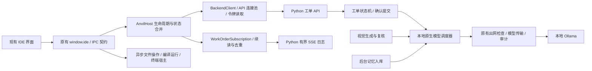

# IDE 与本地 Agent 运行协调

本轮同时维护两个源码目录：`Desktop/开发/AnvilIDE` 的 Electron 主进程，以及 `Desktop/本地工作流/Anvil` 的 Python 后端。IDE 当前使用 Electron + Monaco；编辑器界面、Web 控制台、preload 和 shared 类型均未修改。前端由 Claude 维护，现有 IPC 名称与返回结构保留。

## 职责与运行路径



## IDE 宿主协调

- **启动只执行一次**：并发点击或请求共享同一个启动 Promise；传递设置中的 `--port`。启动依赖明确的仓库虚拟环境，缺失即报错，避免意外使用不兼容的系统 Python。子进程退出或启动失败会收敛状态，启动超时后仅停止宿主自己创建的进程。
- **协议与生命周期分离**：`anvil-host.ts` 负责管理，`anvil-client.ts` 负责普通请求，`anvil-events.ts` 负责事件订阅。普通请求使用有界 keep-alive 连接池，SSE 不占其连接槽位。
- **令牌跟随服务重启**：每次请求异步读取运行目录中的令牌，不再永久缓存旧令牌；尊重 `LOCAL_IDE_RUNTIME`。请求总时限覆盖连接与响应读取，截断响应、网络错误和关闭均会结束等待。
- **减少重复探测**：同一时刻的状态探测共享结果，每次只做一次 `/health`；元数据缓存 30 秒并合并并发刷新。离线时清空过期信息，恢复后重新获取。
- **适配器契约一致**：读取后端实际返回的 `profiles`；保留旧 `presets` / 数组格式兼容。后端返回的默认适配器与 `RunnerOpts` 一致，当前为 `qwen3.5`，宿主将其放在列表首项。
- **SSE 恢复**：支持跨数据块的 CRLF、SSE ID、`Last-Event-ID` 续读、重复事件过滤和缺口快照重置。无结束标记的 EOF 触发有界退避重连；400/403/404 结束连接；后端正常结束仍向界面发送原有 `stream_end`。
- **连接释放**：取消订阅会销毁当前请求并清除重连定时器；旧连接的回调不会删除替换后的新订阅。连续失败最多重试 8 次，45 秒无数据则重连，与后端 15 秒心跳配合。

## IDE 主进程运行效果

- 文件树、读写、创建、重命名、删除和目录检查采用异步文件 API；目录元数据查询每批最多 16 项。文件排序复用中文 Collator。同一路径的保存串行执行，读取会等待已经提交到宿主的保存，避免异步化后引入交错写入。
- 四种编译器独立并行探测，重叠的探测请求共享 Promise；单工具探测仍保留 6 秒上限。
- 编译和程序运行属于同一会话。编译阶段可取消，取消后即使收到迟到的编译成功事件也不会启动程序；错误与退出只通知一次。
- 每个编译会话使用独立产物名，并在结束后清理，避免同时运行同名源文件时争用同一个可执行文件。
- 程序与终端分别为 stdout/stderr 保留增量 UTF-8 解码状态，避免中文跨数据块被破坏。Python 使用无缓冲输出。
- 关闭 IDE 时停止宿主拥有的运行、编译、编译器探测、终端和后端子进程；Windows 使用按 PID 限定的进程树终止。已经由其他入口启动的 Anvil 服务不会被宿主接管或关闭。

## 本地模型与 Agent 协调

新增 `integration/scheduler.py`，接入原生 `integration.models.invoke`。代码 Agent、视觉调用、前台记忆检索和后台记忆入库由同一个进程内准入队列管理。

```toml
[inference]
max_parallel = 1
max_waiting = 32
foreground_burst = 8
```

`max_parallel` 与运行工单数量独立：默认可运行 4 张工单，但同一时刻只向模型发出 1 个原生推理请求。该默认值用于限制多模型竞争资源，可按实际硬件并发能力调整；它不是已测得的最优吞吐配置。

前台请求优先，同一优先级按排队顺序执行；连续放行最多 8 个前台请求后，已有后台等待项获得机会，避免记忆入库长期饥饿。已进入 Ollama 的推理不被抢占。

取消标记沿工单上下文传播，排队中的调用可退出且不发起推理；记忆线程停止时同样可以退出等待。槽位在异常时释放，队列满或排队预算用尽会明确失败。等待时间从既有调用超时中扣除，不在原超时之外额外等待。

`/integrations` 增加 `inference` 状态，包含活跃数、等待数、后台等待数和容量；模型审计增加 `queue_sec`。原有字段仍保留，前端不必改动即可继续使用。

范围：这道调度覆盖 Anvil 原生 Agent 调用。外部客户端直接调用挂载的 `/model` HTTP 网关、其他程序直接使用 Ollama、以及显式 direct 排障路径，不受此队列管理。令牌、配置、记忆等仍包含进程级状态，部署继续采用单进程。

## 验证与使用

IDE 目录：

```powershell
npm run typecheck:node
node --test --test-timeout=30000 tests/main-runtime.test.cjs

# 跨仓库契约验收：临时服务和沙箱，使用真实状态机与 gate；模型为确定性替身
$env:ANVIL_BACKEND_REPO = 'C:\Users\匡溯昀\Desktop\本地工作流\Anvil'
node --test tests/backend-contract.test.cjs
Remove-Item Env:ANVIL_BACKEND_REPO
```

Anvil 后端目录：

```powershell
.\.venv\Scripts\python.exe integration/tests/test_scheduler.py
.\.venv\Scripts\python.exe scripts/selftest.py --core --backend-only
```

主进程回归覆盖启动合并、端口传递、令牌轮换、响应截断、真实本机 HTTP 事件重连与去重、取消重连、文件保存顺序、编译取消与中文分块输出。模型调度回归覆盖容量、异常释放、FIFO、公平性、超时、取消、实际推理预算和工单终态。

本轮验证记录：

| 检查 | 结果 |
|---|---|
| IDE 主进程类型检查 | 通过 |
| IDE 主进程回归 | 10/10 通过 |
| 跨仓库真实 HTTP 验收 | 通过：实际适配器列表、建单、状态机与三道 gate、SSE、暂存审阅、确认落盘；模型输出为替身 |
| 模型调度专项 | 7/7 通过 |
| 后端完整自检 | 首次 19/20 套通过；既有 Job Object 套件中的公网可达假设失败 |
| 失败套件复验 | 通过：3 项离线检查通过，1 项真实公网检查默认跳过 |
| Ruff / 受影响文件 diff 检查 | 通过 |
| IDE renderer 文件哈希 | 与本轮开始时一致 |

原公网测试假定某个外部地址始终可达，无法用于稳定的离线验收。此次仅调整测试：可达结果必须拒绝宣称隔离的分支使用固定进程结果验证；真实公网探针需 `ANVIL_LIVE_TESTS=1`，不可达时跳过可达分支检查，并明确其不能证明网络隔离。生产探针、Job Object 约束和 strict gate 均未修改。修正后只复跑了该失败套件，没有重复整套检查。

此次没有更改前端源码，没有运行完整前端构建或重启正在使用的 IDE。主进程源码需要在下一次 IDE 构建/开发启动时加载；Python 改动需要在下一次后端启动时加载。未重新测试真实模型生成速度，不把协议与调度测试作为模型推理性能的证明。
