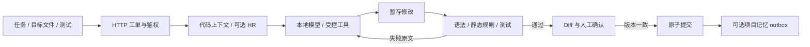

# 大模型工程说明与考核演示

## 问题与交付行为

面向本地模型开发者：将“修改一个 Python 文件”变成能审阅、能验证、能拒绝的工单。模型负责理解任务并提出工具调用；宿主控制上下文、工具执行、验证、资源预算和提交。成功标准是代码按契约通过验证并经确认落盘。

本次申报路线为大模型工程开发。核心路径仅需一个代码模型；HR 与视觉可独立补充展示。

## 模块及设计取舍

| 决策 | 为什么这样实现 | 代价或边界 |
|---|---|---|
| 单文件 Python 工单 | 范围清楚、验证与回滚容易解释 | 不承诺全仓自动重构 |
| 固定状态机与调用预算 | 让模型只在明确节点选择工具，失败有回退/终止 | 灵活性受限；长任务可能需要人输入 |
| 统一配置和适配画像 | API、工作台、验证共享默认模型；按模型能力构造工具契约 | 换模型还要重新跑适配验收 |
| 暂存 + 三道 gate + 确认 | 分离“候选修改”和“真实项目状态” | 多一道审阅；测试质量影响结论 |
| 项目隔离与持久化待入库队列 | 成功经验可重用，后台故障可重试 | 路径变更需重新建库；嵌入模型变化不能直接混用旧向量 |
| 单推理槽位、前台优先 | 减少本地多模型竞争，后台也能逐步获得执行机会 | 吞吐受硬件限制；排队计入预算 |
| 分范围 readiness | 代码考核不依赖视觉权重和嵌入模型 | `code` PASS 不代表 `full` PASS |

主要复用组件：HR、SVSG 的源码快照、manifest 和许可证说明在 `vendor/`。本项目自研部分包括工单编排、上下文接入、模型传输、鉴权、并发管理、提交一致性、故障处理、审阅界面和验收脚本。

## 验收层次及成功定义

| 层次 | 命令 | 通过说明 | 不说明什么 |
|---|---|---|---|
| 资源检查 | `python anvil.py --doctor --scope code` | 必需包、Ollama、代码模型已就绪 | 尚未推理 |
| 离线回归 | `python scripts/selftest.py --core --json .runtime/offline.json` | 故障路径、权限、提交、并发等检查通过；跳过项保留在摘要 | 不代表真实模型成功率 |
| 真实代码链 | `python scripts/integration_e2e.py --scope code` | 真实 HTTP + 本地模型，三道 gate，确认前字节不变，确认后修改、5 个独立边界用例通过，原测试与无关函数未变 | 固定平均值任务，不是通用模型评测 |
| 记忆链 | `python scripts/integration_e2e.py --scope memory` | 上述代码链加真实入库、下张工单召回并进入上下文 | 未验证视觉 |
| 视觉链 | `python scripts/integration_e2e.py --scope full --vision-image C:\素材\bus.jpg` | 再加真实视觉工单、结构化证据、验证及提交 | 固定公交车样例，不是通用分类/OCR |
| 可交付验收 | `python scripts/assess.py --live --scope code` | 汇总离线、真实链、源码哈希、模型摘要、用量、连续两次相同 ZIP | 不代表已上传到平台或本人已完成理论学习 |

三道 gate 中的“类型”检查实际是名称解析、注解完整和符号保留等有限规则，不是完整 mypy 类型推断。独立边界用例包括空列表、正负抵消、单元素、小数均值和负数均值。

## 五分钟演示（代码主线）

1. **0:00–0:45：业务与原理。** 打开考核总览与架构图，解释模型、工具、状态机和 gate 各做什么；说明默认模型来自 `anvil.toml`。
2. **0:45–2:30：真实任务。** 在新演示沙箱创建“实现 average”工单。显示状态流转、模型名、工具参数；待确认时打开 diff，验证原文件未变，再确认并运行测试。脚本验收只自动确认它自己创建的演示目录。
3. **2:30–3:30：失败处理。** 展示故障注入测试与反馈回路，或已有真实失败记录。明确故障注入使用模型替身。
4. **3:30–4:15：工程可追溯。** 打开当次 `summary.json`，指出模型 digest、源码哈希、实际 token、耗时及 `not_tested`。
5. **4:15–5:00：资产复用。** 展示部署指南、依赖锁、流水线配置、源码包与哈希，说明新环境复现步骤。

演示准备：`.\start.ps1 -CodeOnly -Doctor`；`python anvil.py --prepare-demo`；`.\start.ps1 -CodeOnly`。控制台右上角填写 `.runtime/service-token`，演示用工作目录由 `/demo/config` 提供。已实现过的演示文件不自动重置；重演优先使用端到端脚本生成新沙箱。

## 结果记录说明

`summary.json` 记录每次模型调用的实际输入/输出 token 与耗时，缺失计量会单独标注。如需评估模型质量变化，应使用固定任务集、固定预算、保留全部失败并多次运行统计，而非从单个案例推算百分比收益。
