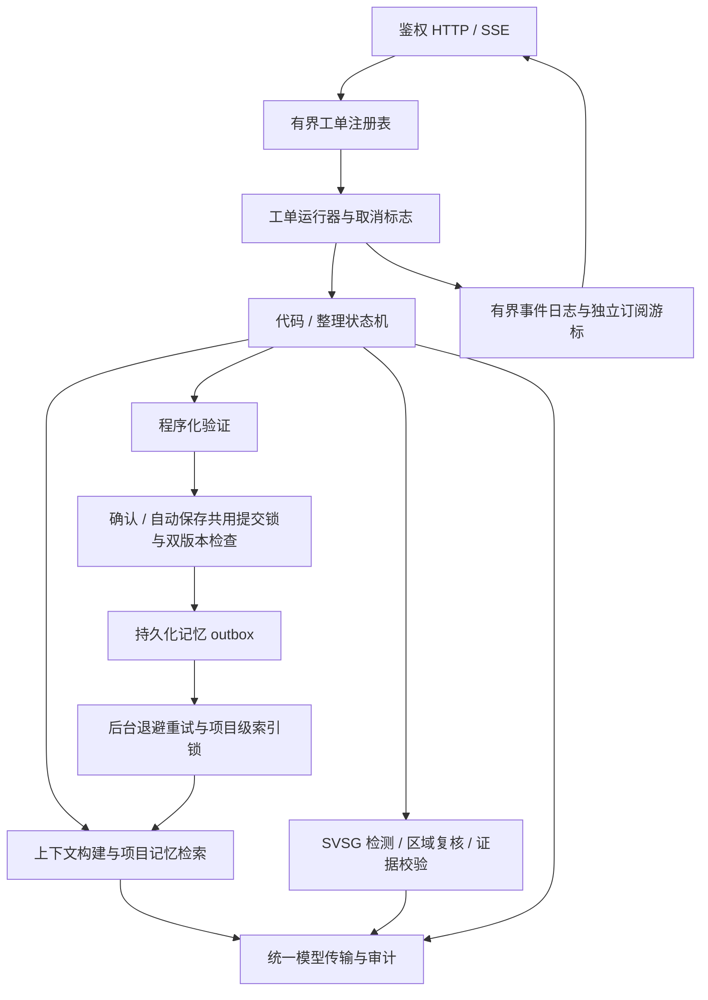

# 后端架构审查与优化

基线：`assessment` / `4caaaa2`，承接已提交的三模块原生集成。日期：2026-10-18。

本轮只调整后端、后端验证脚本与本文档；Web 控制台、扩展及前端资源由 WorkBuddy 独立维护。

## 架构结论

保留单进程原生集成和固定状态机，不再拆出 HR、SVSG 的本机 HTTP 服务。主要缺口在运行生命周期与共享状态，而非增加新的编排框架。



## 已处理的问题

| 原问题 | 后果 | 修复 |
|---|---|---|
| SSE 使用共享消费队列 | 多个页面或扩展抢走彼此的事件，断线不能重放 | 有界事件日志；每连接独立游标；支持 SSE ID、断线续读与缺口快照 |
| 工单与事件在内存中无限保留 | 反复建单可持续创建线程、占用内存 | 默认最多 4 张运行工单、100 张保留工单；每单保留 1024 条事件、80 条时间线 |
| 取消仅在模型调用前检查 | 最后一次生成或最后一道测试期间取消可能仍继续提交 | 模型调用后检查；服务内所有提交走运行器锁；确认、取消、自动提交串行处理 |
| CLI 与服务维护两份提交实现 | CLI 漏检原文件删除，固定临时文件名会冲突 | 共用 `commit_verified`；复制前建立基线；暂存复制后复核；同目标提交互斥 |
| 校验暂存后再次读取复制 | 校验过的内容与最终落盘内容可能不同 | 一次读取并校验字节，写入同目录唯一临时文件；刷新、复核原文件、原子替换；失败清理临时文件 |
| 整理路径只检查文本形式 | 目录 junction / 符号链接可能把移动目标引到根目录外 | 方案闸和执行层都解析真实路径；确认前重新执行方案闸 |
| 暂存复制默认解引用项目中的链接 | 根外文件被复制进暂存区后变得可被工具读取，循环链接还可能导致递归复制 | 暂存统一跳过符号链接与 Windows junction；使用真实 junction 回归验证根外文件未进入暂存 |
| 纯文本整理调用绕过工单预算 | `ask` 没有统一超时与上下文记录 | `ask` 与 `fill_slot` 共用调用额度、超时、取消和审计 |
| 语义整理硬编码地址并直连 Ollama | 配置和唯一模型出口的承诺不一致 | 接入统一模型传输；校验向量维度、数值和有限性；失败明确降级 |
| 全局 HR 锁覆盖慢速嵌入与检索 | 某项目入库拖住所有项目检索 | 引擎创建锁与每项目索引锁分离；同项目读写仍串行 |
| 原生嵌入批接口内部逐句发送请求 | 多次网络往返、重复输入计算 | 使用 `/api/embed`，每批最多 64 条，先去重再推理，验证整批响应后更新有界缓存 |
| 多模型切换下 60 秒嵌入预算过紧 | 初次入库超时、验收等待期限早于重试完成 | 两次 60 秒超时留痕；独立批量推理实测 58.86 秒；后台嵌入预算调为 120 秒，验收窗口按该预算和一次重试推导 |
| outbox 含合法 JSON 数组时异常处理再次崩溃 | 后续正常记录无法入库，后台线程退出 | 验证记录结构；坏记录保留且逐条报错，继续处理其他记录 |
| 记忆线程无停止协议且失败仅手工重试 | 生命周期失控，短暂故障后积压 | 30/60/120/240/300 秒退避重试；新任务唤醒；关闭时停止接单、协作取消并停止记忆线程 |
| 模型白名单检查后允许 HTTP 跳转 | 本机服务重定向可能绕过出网边界 | 统一出口禁止重定向，仅接受无凭据 HTTP(S) URL |
| 挂载网关仍接受旧网关令牌 | 单进程的工单与模型接口认证来源不一致 | 原生入口显式绑定服务令牌；独立网关保留原来的令牌发现方式 |
| 模型异常或非对象响应漏审计 | 错误链路缺少接入证据 | 异常与非法响应统一记录失败状态；网关审计尾部读取限制在 1000 行内存 |
| 测试使用真实运行目录 | 可能改写前端联调中的服务令牌或日志 | 自检各套件独立临时运行目录；真机验收的数据生成也隔离到本次验收目录 |
| “离线”优化测试内含真实嵌入调用 | 无提示占用模型并拖慢其他验收 | 真实嵌入测试须显式设置 `ANVIL_LIVE_TESTS=1` |

## 给前端联调的接口约定

原有成功请求格式保留，以下行为为补充：

| 接口 | 行为 |
|---|---|
| `POST /wo` | 不存在的工作目录、目标或越界路径直接返回 400；达到容量限制返回 429 和 `Retry-After: 2` |
| `GET /wo/{id}/events` | 每条事件带 `seq`，SSE 带 `id:`；不同订阅者收到相同事件 |
| SSE 续读 | 发送 `Last-Event-ID: <上次ID>`，或使用 `?after=<上次ID>`；请求头优先；非法游标返回 400 |
| SSE 缺口 | 超过保留窗口后先发送 `kind=snapshot, reset=true` 的当前状态，再重放仍保留的事件 |
| `?once=1` | 保留原有一次状态快照行为 |
| `POST /wo/{id}/cancel` | 已取消工单幂等返回成功；已经保存的工单返回 `ok=false`，不把已发生的保存描述成已取消 |
| `POST /wo/{id}/confirm` | 冲突、原文件删除、暂存篡改或整理方案失效时仍返回 409；不会覆盖冲突内容 |

无需前端同时修改即可继续使用原有无游标订阅；新增续读能力可由前端按需接入。服务保留单用户令牌模型，业务读写接口均需鉴权。

容量在 `anvil.toml` 的 `[service]` 配置。达到保留上限时优先移除已结束且线程退出的成功、失败、取消或安全拒绝工单；待确认、待输入和升级待处理工单不会被自动淘汰。磁盘审计与运行日志不会随内存工单淘汰而删除。

## 验证方法与边界

```powershell
# 后端离线回归，不读取前端构建结果，不调用真实模型
.\.venv\Scripts\python.exe scripts/selftest.py --core --backend-only

# 新增并发、故障及生命周期回归
.\.venv\Scripts\python.exe service/tests/test_backend_runtime.py

# 三模块真机闭环；只操作本次新建的沙箱
.\.venv\Scripts\python.exe scripts/integration_e2e.py --vision-image .runtime/demo-sandbox/integrated/sample/bus.jpg
```

工单注册表与 SSE 保留窗口仍为单进程内存状态；重启不会恢复待确认工单。原子 outbox 和项目知识持久化，后台未入库项可在下次启动重试。当前设计适用于单用户本地服务，不能直接以多 worker 共享一个运行目录。

取消是协作式的，无法立即中断已进入 Ollama 的推理或已经开始的原子提交。关闭最多等待工单 2 秒、记忆线程 2 秒，并记录尚未退出的线程数；不声称强制终止模型。已进入提交锁的保存先完成，随后到达的取消返回失败。

同目标互斥覆盖本进程内部提交。外部编辑器不共享该锁，末次哈希校验与系统替换之间仍存在极短的外部竞争窗口。测试执行沿用 Windows Job Object 的资源限制，未增加文件或网络隔离。整理操作仍为逐项执行，不能宣传为多文件事务或完整目录内容版本控制。

视觉继续遵守原来的交付/待复核/拒绝状态，未放松证据锚定；同一视觉模型做区域复核的能力边界不变。

## 本轮验证记录

- 后端离线自检 `--core --backend-only`：18/18 套件通过，覆盖原服务、网关、上下文、状态机、整理、安全与兼容层。
- 新增后端运行时回归共 27 条：并发提交、末次测试取消、末次模型调用取消、SSE 多订阅与续读、过载限流、队列损坏、项目锁隔离、后台关闭、批嵌入去重与失败原子性、统一令牌、真实 junction 边界；分批执行通过。
- 原生集成测试 21 条与新增运行时测试曾合并执行 46 条通过；后续新增的令牌绑定和 junction 暂存回归另行针对性通过。
- 本轮新模块与关键修改通过 Ruff、未定义名字扫描、Python 编译及后端范围 `git diff --check`。

真实推理证据与限制：

| 记录 | 结果 |
|---|---|
| `.runtime/acceptance/ae35f4a30c/report.json` | 真实代码工单通过三 gate 并确认保存；记忆调用触及原 60 秒超时，未在原验收窗口内完成入库，整链判失败 |
| 本轮独立 `/api/embed` 探针 | 两条输入成功返回两条 1024 维向量，58.86 秒；据此增加后台预算并减少逐句请求 |
| `.runtime/acceptance/89cd6a4c1a/report.json` | 原脚本 20 秒启动窗口内未就绪；验收脚本启动窗口改为 60 秒 |
| `.runtime/acceptance/96f6820113/report.json` | 60 秒窗口内服务启动、资源检查通过；代码模型侦察请求触及 180 秒超时，工单 failed，未得到完整三模块通过结论 |
| 最小代码模型探针 | 无工具、单条“Reply OK.”消息、4096 上下文、最多 8 个输出 token，仍触及 60 秒超时；推理超时可在脱离工单编排后复现 |

当前版本的完整真机复验尚未全绿，实际阻塞点为本地模型请求耗时；保留失败报告与接入日志供继续定位。原有验收通过的 185 秒报告作为历史基线保留。后端未取消超时上限或放松 gate 来获取成功状态。

`/integrations` 与 `--doctor` 补充返回 `inference_tested=false`、`readiness=resources-only`：模型标签、依赖与权重存在只表示资源齐备。诊断请求不会隐式执行一次昂贵推理。
