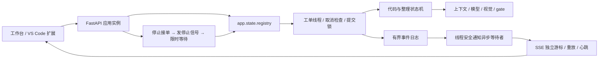

# 后端运行时优化 · 2026-11-04

本次以 `Desktop/本地工作流/Anvil` 的现有工作区为基线，保留此前尚未提交的修改。这个仓库承载 Python/FastAPI 后端、Web 控制台和 VS Code 扩展；本次未修改编辑器内核或前端。

## 架构决策

继续采用本地单进程、模块化后端。HTTP 层负责协议与鉴权，应用实例拥有工单注册表，运行器拥有工单状态与生命周期，事件缓冲区负责线程到异步订阅者的通知。模型传输、记忆、视觉和验证逻辑保持原有分工。



现阶段值得拆清的是状态归属和调用边界。已有 HTTP、状态机与原生集成模块可以继续复用，无需额外引入本地消息服务或把内部对象调用改成多个 HTTP 服务。

## 已实施的变化

| 原问题 | 当前行为 | 主要实现 |
|---|---|---|
| 模块全局 `REGISTRY` 让多次 `build_app()` 共享工单，任一实例关闭都能关闭共享注册表 | 默认每个应用创建自己的注册表；允许显式注入；统一入口的工单路由、记录查询与关闭使用同一个实例 | `service/app.py`、`anvil.py` |
| 每条 SSE 连接每 250 ms 遍历事件缓冲区，空闲连接持续唤醒；新事件需要等待下一次轮询 | 工单线程通过 `call_soon_threadsafe` 唤醒订阅者；无事件时只等待 15 秒心跳或 900 秒空闲截止时间；等待不占线程池 | `service/events.py`、`service/app.py` |
| 读完事件到注册等待之间可能漏掉通知；断线与发布同时发生可能操作已取消 Future | 游标检查与注册等待共用锁；回调在所属事件循环中检查 Future 状态；超时、断线均释放等待者 | `service/events.py` |
| 线程的最后一条事件发出后，线程存活状态可能短暂仍为真 | 运行器在 `finally` 中发送生产完成通知，SSE 重读尾部事件后结束；后续人工确认事件仍可追加、重放 | `service/runner.py`、`service/events.py` |
| `shutdown()` 在设置等待截止时间之前逐一调用 `cancel()`，可无限等待正在提交的工单锁 | 关闭时直接发协作停止信号，再按共享截止时间等待工单退出；已进入的提交完成，未退出线程如实计数 | `service/runner.py` |

原有 HTTP 路径、鉴权、人工确认、取消返回值、SSE ID、`Last-Event-ID`、`after`、缺口快照及 `once=1` 保留。前端无需配套改动。

Python 内部接入有一处迁移：不再导入 `service.app.REGISTRY`。应通过应用实例访问，或在工厂中明确注入：

```python
from service.app import build_app
from service.runner import RunnerRegistry

registry = RunnerRegistry(max_active=4, max_retained=100)
app = build_app(registry=registry)
assert app.state.registry is registry
```

`anvil.build_app(registry=...)` 也支持相同注入方式。相关既有测试已完成迁移。

## 验证结果

变更前的后端离线自检为 18/18 套件通过；变更后新增运行时测试套件，完整自检为 19/19 套件通过。新增 13 项回归覆盖多应用工单隔离、统一入口注入、20 个订阅者同时唤醒、读/等竞争、断线清理、发布/取消竞争、尾事件、确认后重放、心跳、空闲超时、异常游标、事件容量及提交锁阻塞期间的有界关闭。

真实回环 HTTP 检查使用临时 uvicorn 服务与 httpx 客户端：3 个订阅者中 1 个提前断线，其余 2 个均按顺序收到全部 16 条事件与结束标记；完成后等待者为 0，未鉴权请求返回 401。未调用模型，未重启现有服务；报告保存在 `.runtime/verification/backend-2026-11-04/http-smoke.json`。本轮修改的 Python 文件通过 Ruff，受影响已跟踪文件通过 `git diff --check`。

```powershell
.\.venv\Scripts\python.exe scripts/selftest.py --core --backend-only
.\.venv\Scripts\python.exe service/tests/test_runtime_isolation.py
.\.venv\Scripts\python.exe scripts/benchmark_sse.py
```

SSE 微基准直接消费生产代码的异步生成器，64 个订阅者空闲 1.05 秒后发布同一个事件。本机本轮单次对照结果：

| 指标 | 修改前工作区副本 | 修改后 |
|---|---:|---:|
| 空闲期间缓冲区读取次数（包括首次读取） | 320 | 64 |
| 事件交付延迟 P50 | 262.774 ms | 4.608 ms |
| 事件交付延迟 P95 | 263.034 ms | 5.364 ms |

报告位于 `.runtime/verification/backend-2026-11-04/sse-benchmark.json`。`scripts/benchmark_sse.py --baseline-service <修改前service/app.py副本> --report <报告路径>` 可重新对照；测试使用临时令牌和日志目录。上述为同一次发布在订阅者之间的分位数，不含 HTTP 网络、前端渲染和模型推理，也不能推导整张工单的加速比例。

## 当前边界与后续方向

- **运行方式**：仍为单用户、单进程、一个运行目录。此次隔离工单注册表；令牌、模型配置、记忆工作线程和磁盘路径仍有进程级状态，尚不支持多租户或多个 worker 共享运行目录。
- **取消与关闭**：停止是协作式的，已进入模型 HTTP 请求或提交临界区的操作不会被强制中断。工单等待默认最多 2 秒，记忆线程另有 2 秒等待预算；不能把这解释为整个进程必定在 4 秒内退出。
- **持久化**：待确认工单和事件历史仍保存在内存，重启不能恢复。需要断点恢复时，应先持久化工单状态、原文件/暂存版本与事件序号，并定义重启后的重新验证流程，随后再考虑多进程执行。
- **模型调度**：并发工单数并不等于可同时推理的模型数。后续应基于真实模型的排队、加载与生成耗时，再决定前台代码、视觉与后台嵌入的并发配额和优先级；本轮未重新执行真实模型推理，未声称解决历史模型超时。
- **日志查询**：工单记录接口仍扫描全局 JSON 目录。历史记录扩大后，可按工单分区或建立索引，并补旧日志兼容读取；此次未更改现有审计文件格式。

这些扩展涉及新的持久化或调度契约，应分别验证故障恢复与真实工作负载；当前已交付的优化聚焦工单所有权、事件分发和关闭协议。
